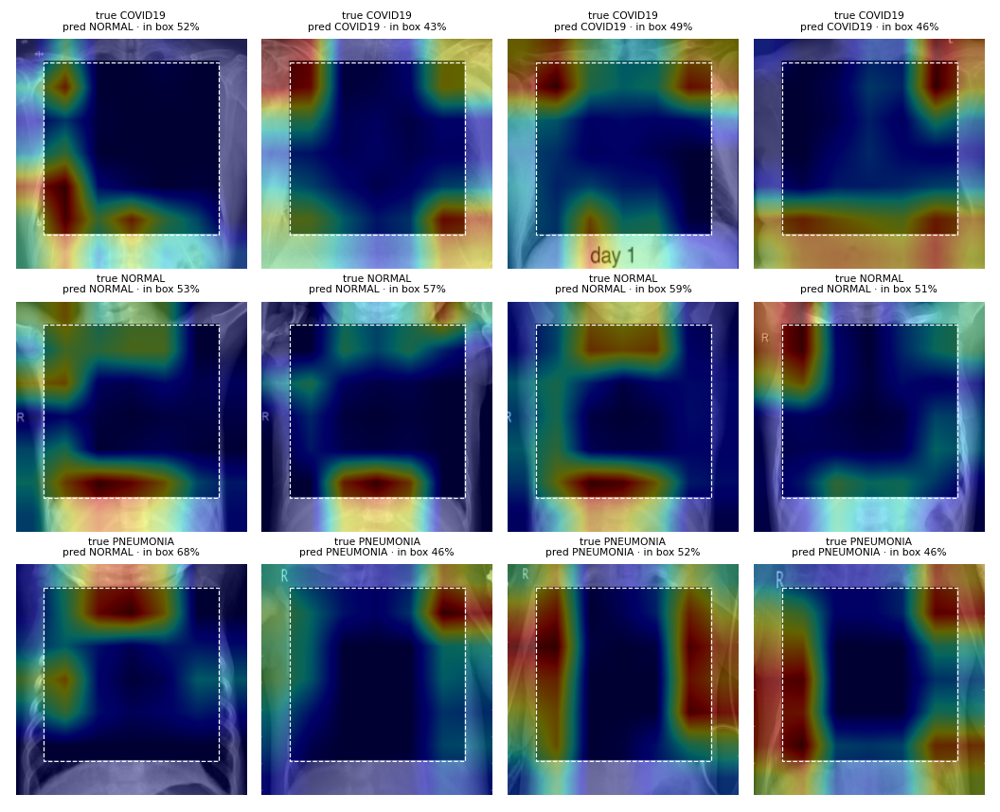
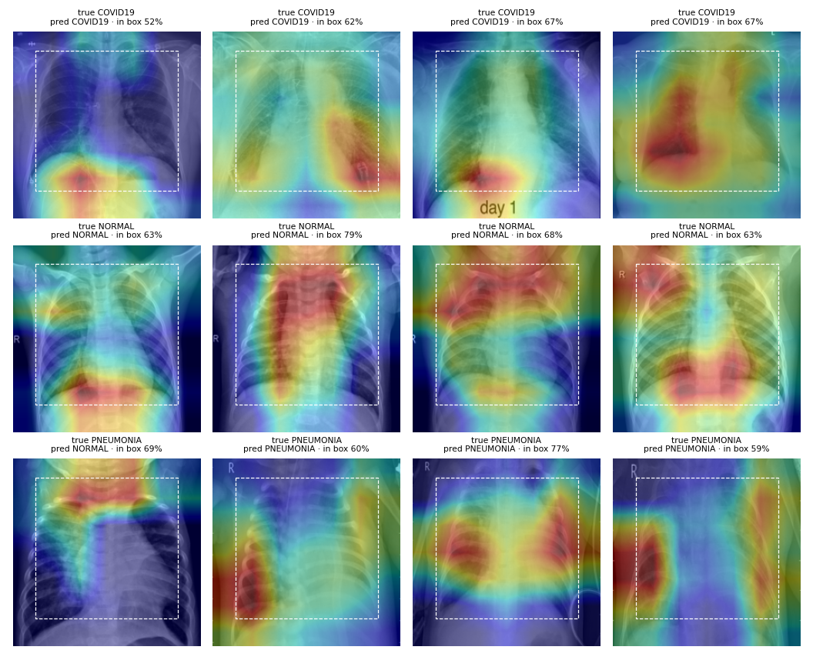

# Does a COVID-19 X-ray classifier look at the lungs?

[](https://github.com/anupbagale/covid-xray-shortcut-learning/actions/workflows/ci.yml)
[](https://colab.research.google.com/github/anupbagale/covid-xray-shortcut-learning/blob/main/notebooks/run_all_colab.ipynb)
[](LICENSE)

My first version of this project trained a small CNN on chest X-rays and reported
**98% accuracy** for COVID-19 vs normal and **93%** for COVID-19 vs normal vs pneumonia.
Those numbers came from a test set that was also used to monitor training, and
accuracy hid a class imbalance. More importantly, they could not tell whether the
model had learned anything about the lungs at all.

This version asks that question directly: **when a model classifies these X-rays,
is it reading the lungs, or is it recognising where each image came from?**

**Short answer:** the central lung region is not needed. A DenseNet121 that never sees
it still tells the three classes apart with an AUC of 0.983, almost as well as with the
whole image (0.994). A classifier that sees only file size and format does equally well
(0.989), and the example images suggest a simple reason: the normal and pneumonia X-rays
appear to be mostly of young children, the COVID-19 ones of adults. The high accuracy on
this dataset is therefore not evidence that a model detects COVID-19.

## Why this matters

Public COVID-19 X-ray datasets were assembled quickly during the pandemic, often by
combining COVID images from one set of sources with normal and pneumonia images from
others. Then the class label is correlated with the hospital, scanner, patient age,
image format or text markers burned into the image. A CNN can learn those
**shortcuts** and still score near-perfectly on a test set drawn from the same mix,
while failing on images from a new hospital. This has been shown for widely used
COVID X-ray datasets ([DeGrave et al., 2021](https://doi.org/10.1038/s42256-021-00338-7)),
and a review of COVID imaging models found methodological problems that made none of
them ready for clinical use ([Roberts et al., 2021](https://doi.org/10.1038/s42256-021-00307-0)).

## How the question is tested

| Test | What it does | If the model reads the lungs | If it relies on shortcuts |
|---|---|---|---|
| **Metadata-only classifier** | Random forest on file size, format, colour mode and brightness; never sees image content | AUC ≈ 0.5 | AUC well above 0.5: the label can be read off the file |
| **Duplicate check** | Byte-identical and near-identical (perceptual hash) images shared by train and test | none | test scores are inflated by memorised images |
| **Train with lungs hidden** | DenseNet121 trained *and* tested with the lung region blacked out | AUC ≈ 0.5 | AUC well above 0.5: information outside the lungs predicts the label |
| **Hide lungs at test time** | Normally trained models tested on lung-occluded images | AUC drops toward 0.5 | AUC stays high |
| **Grad-CAM** | Share of each heatmap inside the lung region | well above the box's share of the image | near or below it |

## Results

All numbers are on the 1,288 untouched test images. Full tables, confusion matrices
and per-image predictions: [`results/summary.md`](results/summary.md). Brackets are 95%
bootstrap confidence intervals.

### 1. The models score highly, measured properly

| Model | Accuracy | Balanced accuracy | Macro AUC | COVID-19 sensitivity | COVID-19 specificity |
|---|---|---|---|---|---|
| Majority-class baseline | 0.664 | 0.333 | 0.5 | 0 | 1 |
| Original v1 CNN | 0.943 | 0.943 (0.925–0.957) | 0.988 (0.984–0.992) | 0.966 (0.927–0.992) | 0.997 (0.994–1.000) |
| DenseNet121 | **0.953** | **0.960** (0.946–0.973) | **0.994** (0.991–0.996) | 0.966 (0.930–0.993) | 1.000 (1.000–1.000) |

DenseNet121 found 112 of 116 COVID-19 cases and labelled none of the 1,172 other images
as COVID-19. Its main error was calling 47 pneumonia images normal. The v1 CNN, now
evaluated on a clean test set, reaches 94.3%; the 92.8% reported in v1 was not
inflated much by reusing the test set during training.

These are the kind of numbers often reported as "AI detects COVID-19 from X-rays".
The next two results show why they cannot be read that way here.

### 2. The labels can be read off the files

A random forest that sees only file metadata (size, aspect ratio, file size, format,
colour mode, brightness) and nothing of the image content reaches a **macro AUC of 0.989**
(balanced accuracy 0.899). The classes clearly differ in how their files were produced:

| Class | Median size (w × h) | Median file size | Format | Colour mode |
|---|---|---|---|---|
| COVID-19 | 1166 × 1028 | 355 KB | JPEG 63%, PNG 34%, BMP 3% | RGB 65%, gray 28%, RGBA 6% |
| Normal | 1615 × 1322 | 535 KB | JPEG 100% | RGB 100% |
| Pneumonia | 1144 × 776 | 143 KB | JPEG 100% | RGB 100% |

The mix of formats in the COVID-19 class suggests several sources, while normal and
pneumonia images are uniform but differ in size and shape. The Kaggle page does not
document where each class came from. The CNNs never see file size or format (every
image is converted to grayscale and resized), but the differences point to different
sources, and those usually leave traces in the pixels too: framing, exposure, patient
population, burned-in markers. Pneumonia images are typically much wider than tall
(1144 × 776, against 1615 × 1322 for normal), so squeezing them to a square distorts
body shape in a class-specific way. That is one possible cue; it was not tested
separately here.

### 3. The model does not need the lungs

DenseNet121 trained **and** tested with the lung region blacked out (57% of the image
hidden, leaving what is typically the neck, shoulders, sides of the chest, upper
abdomen and any markers):

| | Lungs visible | Lungs hidden |
|---|---|---|
| Accuracy | 0.953 | 0.900 |
| Macro AUC | 0.994 | **0.983** (0.979–0.987) |
| COVID-19 sensitivity | 0.966 | 0.862 (0.797–0.922) |
| COVID-19 false positives (of 1,172) | 0 | 2 |

Hiding the central lung region costs very little. Most of what separates these classes,
COVID-19 included, is available outside it. A model that does this well without it
cannot be trusted to have learned lung pathology when it does see it.

Where does the lungs-hidden model look instead? Its heatmaps sit on the strip around the
black box: the chest wall, the outer edges of the lungs, the diaphragm and the shoulders.



The box does not cover the outer lung edges, so this model still sees some lung tissue,
and part of its score could come from there. But the same strip also carries body size
and shape, which leads to the most likely shortcut in this dataset:

- **Patient age.** In these examples, most normal and pneumonia X-rays appear to be of
  young children (small, narrow chests, arms raised), while the COVID-19 X-rays appear to
  be of adults. If that holds across the dataset, a model can separate COVID-19 from the
  other classes by body size and shape alone, without learning anything about COVID-19.
  This is a visual impression from a few images, not a measured result; the dataset has
  no age information.
- **Burned-in markers.** Side markers ("R") appear in different styles and positions,
  and one COVID-19 image carries the text "day 1". These are typical source fingerprints,
  though the heatmaps do not show the model relying on them consistently.
Also worth noting: COVID-19 pneumonia and other viral pneumonias often look alike on
X-rays, so near-zero confusion between COVID-19 and pneumonia is itself a warning sign.

### 4. The softer evidence points the same way

- **Hiding the lungs at test time** from the normally trained models drops macro AUC
  to 0.696 (DenseNet121) and 0.815 (v1 CNN), and balanced accuracy to near chance
  (0.339 and 0.485). This shows the models *use* the lung region when it is there, but
  it is weaker evidence than result 3: a black box is something these models never saw
  in training, so part of the drop is simply confusion at an unfamiliar image.
- **Grad-CAM**: 66% of DenseNet121's attention falls inside the lung box, against 57%
  for attention spread evenly, a mild preference. The v1 CNN shows none (56%), and for
  pneumonia images it looks *outside* the box more than chance would (47% inside).



### 5. No train/test leakage

The test set is clean. There are 32 groups of byte-identical files, but each stays
within one split and one label. No test image has an identical or near-identical copy
in the training data.

### Conclusion

On this dataset, near-perfect COVID-19 classification is easy and says little about
COVID-19. The classes can be separated from file metadata alone, and from the image with
the central lung region hidden, and the COVID-19 and non-COVID images appear to come from
different patient populations (adults vs mostly children). To show that a model detects
the disease, it would need to be tested on images from a different hospital than the
training data, ideally with COVID-19 and non-COVID images from the same population and
collected the same way, and with real lung masks instead of a box.

## Methods

**Data.** [Chest X-ray (Covid-19 & Pneumonia)](https://www.kaggle.com/datasets/prashant268/chest-xray-covid19-pneumonia)
on Kaggle, pre-split into train and test folders. The classes are imbalanced:

| Class | Train | Test |
|---|---|---|
| COVID-19 | 460 | 116 |
| Normal | 1,266 | 317 |
| Pneumonia | 3,418 | 855 |
| **Total** | **5,144** | **1,288** |

Always predicting "pneumonia" already gives 66% test accuracy. (The copy used for v1
had 1,292 test images; the current Kaggle download has 1,288.)

**Splits.** 15% of the training images (stratified by class, fixed seed) form a
validation set. The best epoch is chosen on validation AUC. The test set is used once,
at the end. The split for each run is saved in `results/<run>/splits.csv`.

**Preprocessing.** Every image is converted to grayscale (so RGB vs grayscale files
look the same), resized to 224×224 and repeated to three channels. Augmentation is
small rotations, zoom, shifts and contrast changes. **No flips**: an X-ray is never
upside down, and a left-right flip puts the heart on the wrong side.

**Models.**
- `original_cnn`: the v1 architecture, unchanged, as a baseline. About 98% of its
  parameters sit in one Flatten → Dense layer.
- `densenet121`: ImageNet-pretrained DenseNet121 (the CheXNet backbone). The new
  head is trained first, then the last dense block is fine-tuned at a low learning
  rate. Batch-norm layers stay frozen.

Training uses Adam, class weights to balance the classes, early stopping on
validation AUC and the best checkpoint.

**Metrics.** Accuracy next to the majority-class baseline; balanced accuracy;
per-class sensitivity, specificity and PPV; one-vs-rest and macro AUC; confusion
matrices. 95% confidence intervals come from 1,000 bootstrap resamples of the test set.

**Lung region.** A fixed box covering 10–85% of the image height and 12–88% of its
width (`DEFAULT_LUNG_BOX` in `src/cxrshortcut/images.py`), about 57% of the image.

## Reproduce

On Colab: open [`notebooks/run_all_colab.ipynb`](notebooks/run_all_colab.ipynb) and run all cells.

Locally (a GPU is strongly recommended for training):

```bash
pip install -r requirements.txt && pip install -e .
python scripts/audit_dataset.py --data-root PATH/TO/Data
python scripts/run_experiment.py --data-root PATH/TO/Data --model original_cnn --epochs 25 --eval-occluded
python scripts/run_experiment.py --data-root PATH/TO/Data --model densenet121 --epochs 10 --fine-tune-epochs 10 --eval-occluded
python scripts/run_experiment.py --data-root PATH/TO/Data --model densenet121 --name densenet121_occluded --epochs 10 --fine-tune-epochs 10 --occlude
python scripts/make_report.py
pytest   # 45 tests on a synthetic dataset, CPU only
```

`--classes COVID19 NORMAL` repeats any step as the binary task from v1.

To try the pipeline without downloading anything, generate a small synthetic dataset.
Its COVID class has a planted shortcut (different file format, size and a corner marker),
and the audit and the lungs-hidden model both catch it:

```python
from cxrshortcut.synthetic import make_synthetic_dataset
make_synthetic_dataset("synthetic")   # then use --data-root synthetic
```

Each run saves its configuration and library versions (`run_info.json`), training
history, per-image predictions, metrics and Grad-CAM examples.

## Repository layout

```
src/cxrshortcut/
  data.py        index train/test folders, stratified validation split
  images.py      loading, augmentation, lung-box occlusion (tf.data)
  audit.py       metadata shortcut test, exact and near-duplicate check
  models.py      original_cnn, small_cnn, densenet121
  train.py       training with validation-based model selection
  metrics.py     imbalance-aware metrics and bootstrap CIs
  evaluate.py    test-set predictions and metrics
  gradcam.py     Grad-CAM and share of attention inside the lung box
  synthetic.py   fake dataset for tests
scripts/         audit_dataset.py, run_experiment.py, make_report.py
notebooks/       run_all_colab.ipynb; original/ holds the v1 notebooks
tests/           pytest suite, runs in CI on every push
results/         generated metrics, predictions and figures
```

## Limitations

- **The lung region is a rectangle, not a segmentation.** It includes the heart and
  mediastinum, and in many images the outer edges of the lungs fall outside it; the
  Grad-CAM examples show the lungs-hidden model looking there. So that model still sees
  some lung tissue. Real lung masks from a segmentation model would make this test
  sharper; a wider box would be a quick first check.
- **Patient age was not measured.** The age difference between classes is a visual
  impression from example images. The dataset has no age labels.
- **No patient IDs.** The dataset does not identify patients, so images of the same
  patient may sit in both train and test. The near-duplicate check catches only very
  similar images.
- **Grad-CAM is coarse** (a 7×7 grid for DenseNet121 at 224 px) and is not a reliable
  explanation on its own. It is supporting evidence next to the occlusion tests.
- **One dataset, one seed.** Each model was trained once. The confidence intervals cover
  test-set sampling, not training randomness. The results describe what this dataset
  allows a model to learn. They say nothing about clinical performance, and none of
  these models should be used for diagnosis.

## Version history

- **v2 (October 2026)**: rebuilt as a shortcut-learning study: dataset audit, held-out
  validation split, imbalance-aware metrics with confidence intervals, pretrained
  DenseNet121, lung-occlusion tests, Grad-CAM, tests and CI. Finding: the classes can
  be separated without the central lung region (AUC 0.983).
- **v1 (June 2024)**: two Colab notebooks, kept in [`notebooks/original/`](notebooks/original/).
  What was wrong with them, and what v2 changes:
  - The test folder was passed as `validation_data`, so it guided training. There was no untouched test set.
  - Only accuracy was reported. The binary model's first-epoch accuracy, 73.2%, is exactly
    317/433: it was predicting "normal" for every image.
  - Vertical flips were used as augmentation.
  - 7.4M of the CNN's 7.5M parameters were in a single Flatten → Dense layer.
  - Hard-coded Google Drive paths, no seeds, no README, and a placeholder CI workflow.

## License

Code: [MIT](LICENSE). The X-ray dataset is not included in this repository; download it from
[Kaggle](https://www.kaggle.com/datasets/prashant268/chest-xray-covid19-pneumonia).
The example figures in `results/` show a small number of X-rays from that dataset, which
remain subject to the terms of the Kaggle dataset and its original sources.
